# Manhunt

Real-world hide and seek. Players join a lobby on their phones, share live GPS
positions, and seekers get distance readouts and a compass arrow pointing at
their chosen hider.

Built to keep working on **spotty internet**: the client and server talk over
Socket.IO with automatic reconnection, players who drop offline keep their
identity for 5 minutes and resume seamlessly, stale positions are labeled
instead of silently shown as live, and a service worker keeps the app shell
loading without connectivity.

<p align="center">
  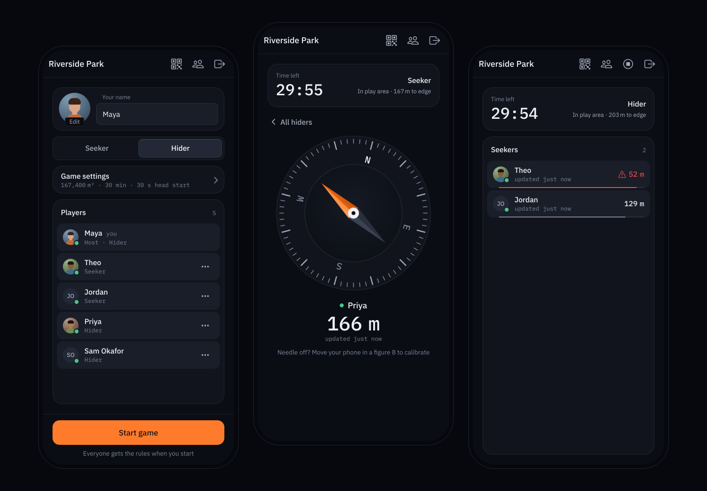
</p>

## Walkthrough

One round, start to finish, as five friends play it. Every screen below is the
real app, captured at phone size (390 × 844) from a scripted game.

### 1. Start a lobby

<table>
  <tr>
    <td width="33%" valign="top">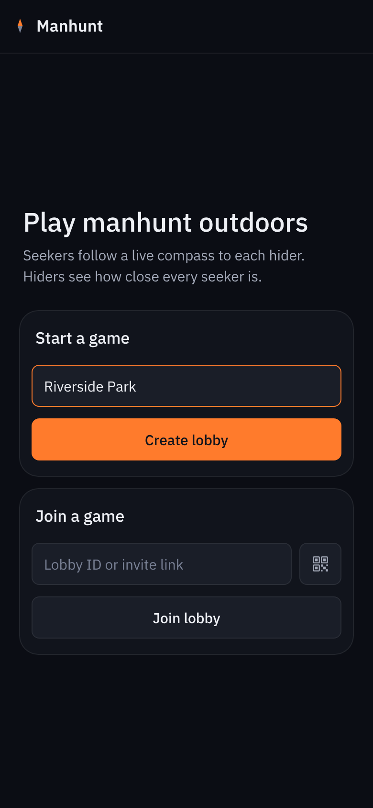</td>
    <td width="33%" valign="top">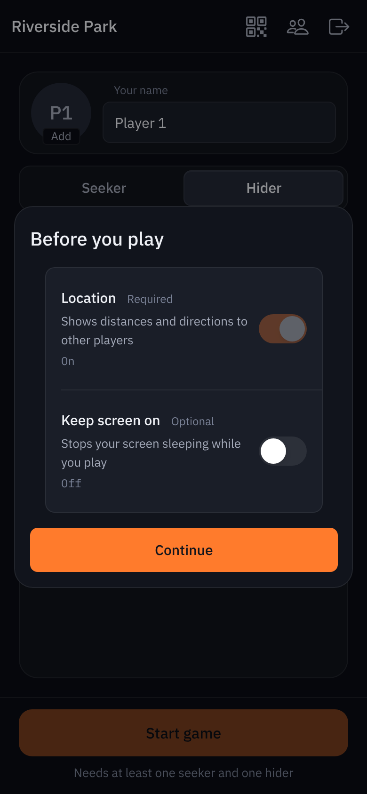</td>
    <td width="33%" valign="top">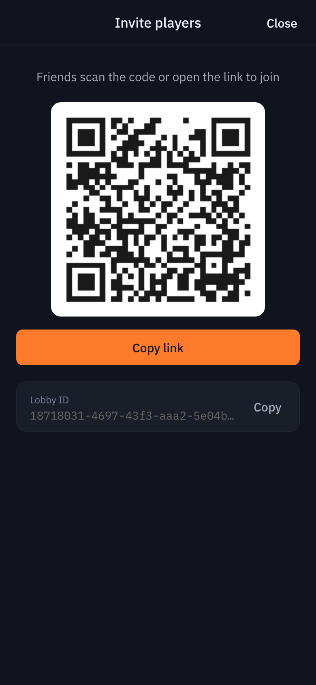</td>
  </tr>
  <tr>
    <td valign="top"><b>Create or join.</b> Name the lobby and tap <i>Create lobby</i>. Friends join with the lobby ID, a pasted invite link, or the QR button, which scans an invite with the camera.</td>
    <td valign="top"><b>One permission.</b> Location is required; keeping the screen on is optional and never blocks you.</td>
    <td valign="top"><b>Invite.</b> The QR button in the top bar shows a code anyone can scan with their phone camera to land straight in the lobby.</td>
  </tr>
</table>

### 2. Gather in the lobby

<table>
  <tr>
    <td width="33%" valign="top">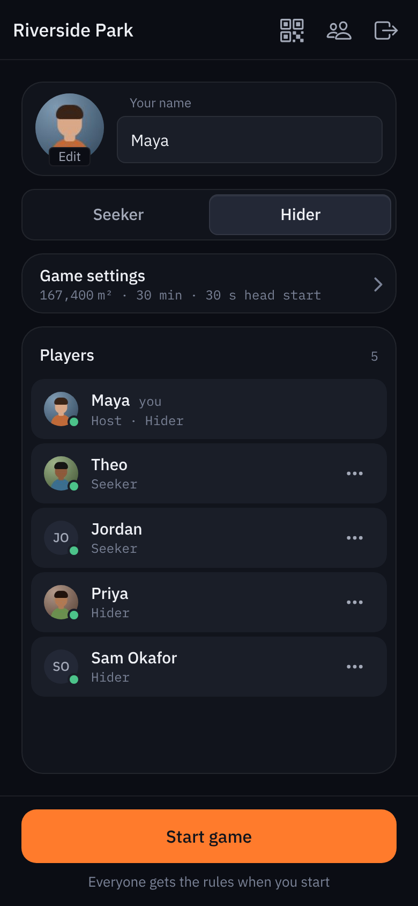</td>
    <td width="33%" valign="top">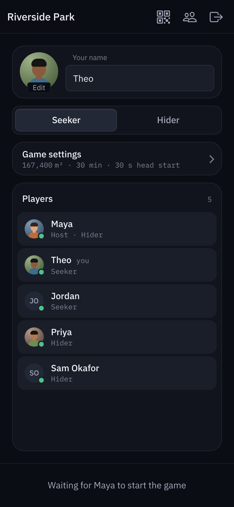</td>
    <td width="33%" valign="top">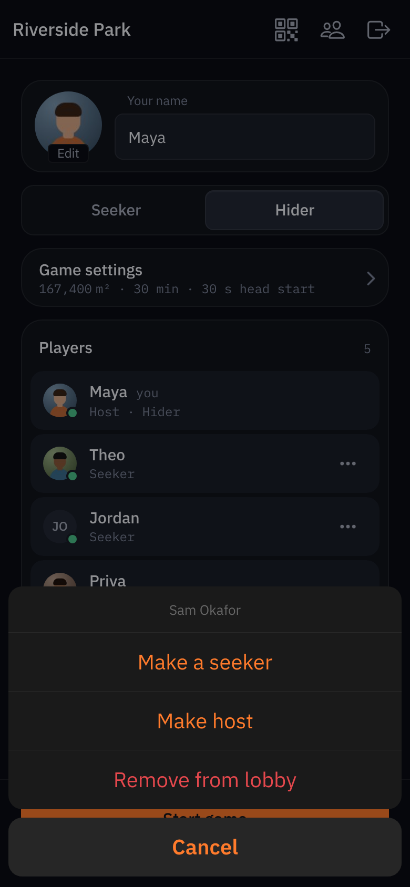</td>
  </tr>
  <tr>
    <td valign="top"><b>Everyone sets up.</b> A name, a small profile picture (tap the circle) and a role. The green dot means a player is connected. Only the host gets <i>Start game</i>, and only once there is a seeker and a hider.</td>
    <td valign="top"><b>Guests wait for the host.</b> They see the same rules and players, read-only.</td>
    <td valign="top"><b>The host is in charge.</b> The ••• menu on any player switches their role, hands over the host role, or removes them. The server enforces it, not just the app.</td>
  </tr>
</table>

### 3. Set the rules

<table>
  <tr>
    <td width="33%" valign="top">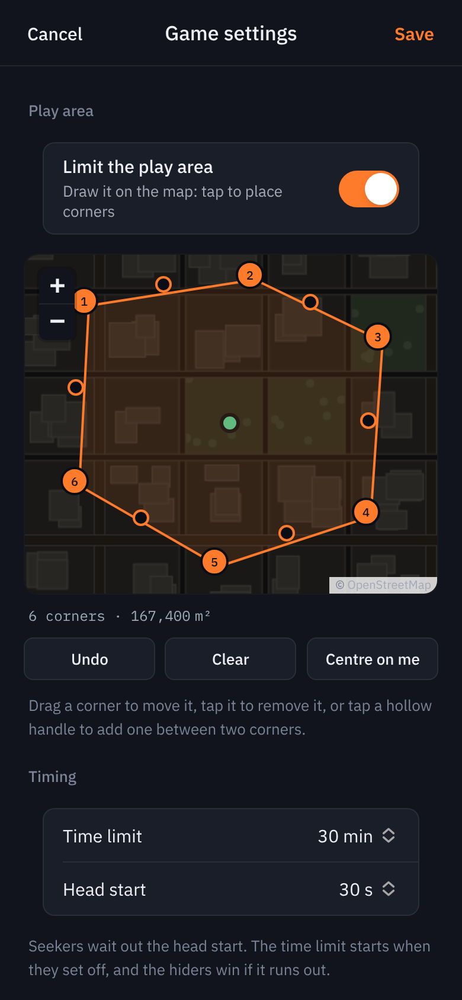</td>
    <td valign="top">
      <b>Draw the play area.</b> The host taps the map to place corners. Drag a corner to move it, tap it to remove it, or tap a hollow handle to add one between two corners. The area updates live, and a shape whose edges cross can't be saved.
      <br><br>
      <b>Time limit and head start.</b> Seekers wait out the head start while hiders' positions stay hidden. The clock starts when seekers set off; the hiders win if it runs out.
      <br><br>
      Everyone else can open the same sheet to see the rules and the area, but can't change them.
    </td>
  </tr>
</table>

### 4. Seek

<table>
  <tr>
    <td width="33%" valign="top">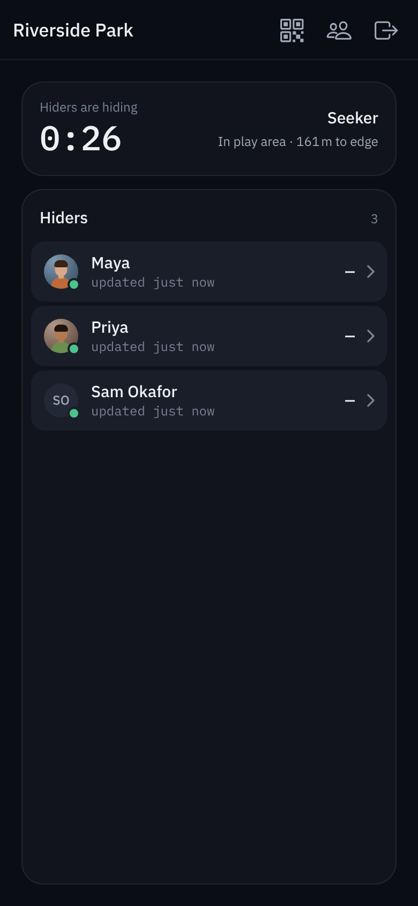</td>
    <td width="33%" valign="top">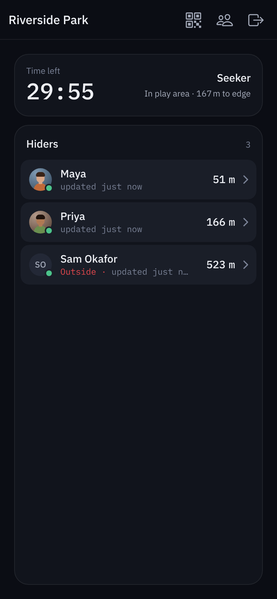</td>
    <td width="33%" valign="top">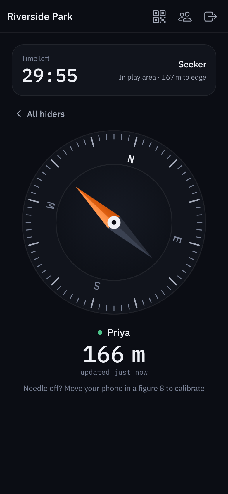</td>
  </tr>
  <tr>
    <td valign="top"><b>Head start.</b> Seekers count down while hiders scatter. Hider positions are withheld by the server until it ends.</td>
    <td valign="top"><b>The hunt.</b> Every hider with their distance and how fresh their position is. Anyone who leaves the play area is marked <i>Outside</i>.</td>
    <td valign="top"><b>The compass.</b> Tap a hider: the needle points at them, the dial turns so N stays north, and the distance updates as you move.</td>
  </tr>
</table>

### 5. Hide

<table>
  <tr>
    <td width="33%" valign="top">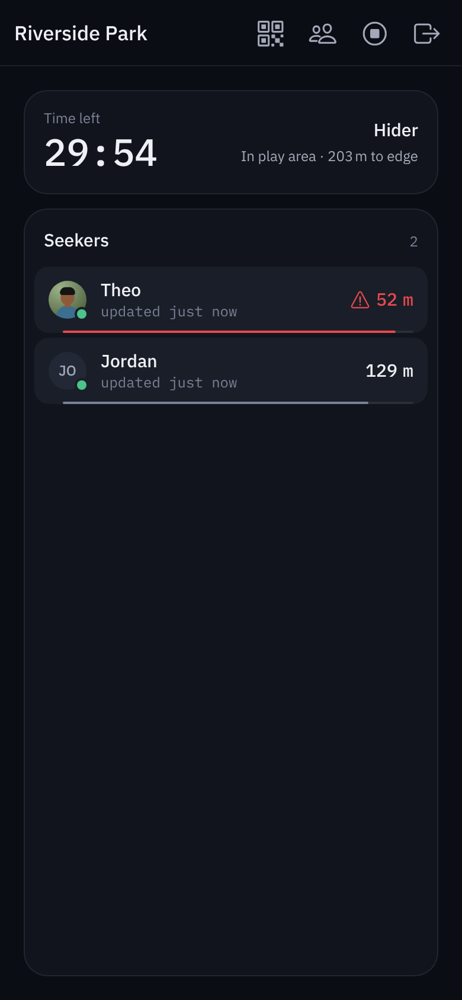</td>
    <td width="33%" valign="top">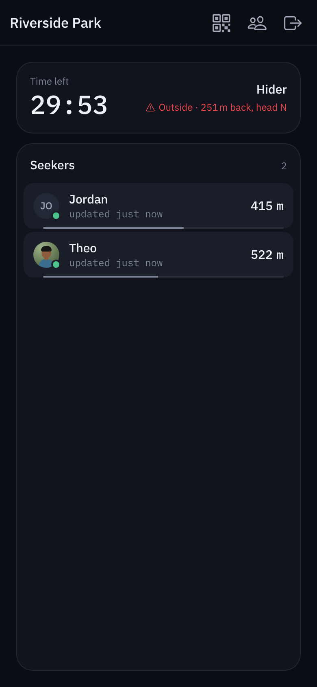</td>
    <td width="33%" valign="top">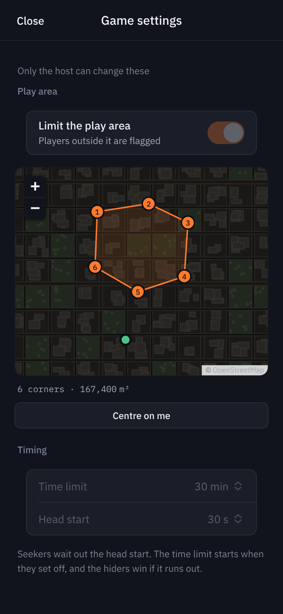</td>
  </tr>
  <tr>
    <td valign="top"><b>Watch them close in.</b> Seekers sorted by distance, with a bar that fills as each one gets closer. Under 100 m it turns red with a warning icon.</td>
    <td valign="top"><b>Stay in bounds.</b> Step outside the area and the status card says how far back it is and which way to go.</td>
    <td valign="top"><b>See the area.</b> Tap the status card to open the map, framed to show both the area and you.</td>
  </tr>
</table>

### 6. Weak signal, and the end of the round

<table>
  <tr>
    <td width="33%" valign="top">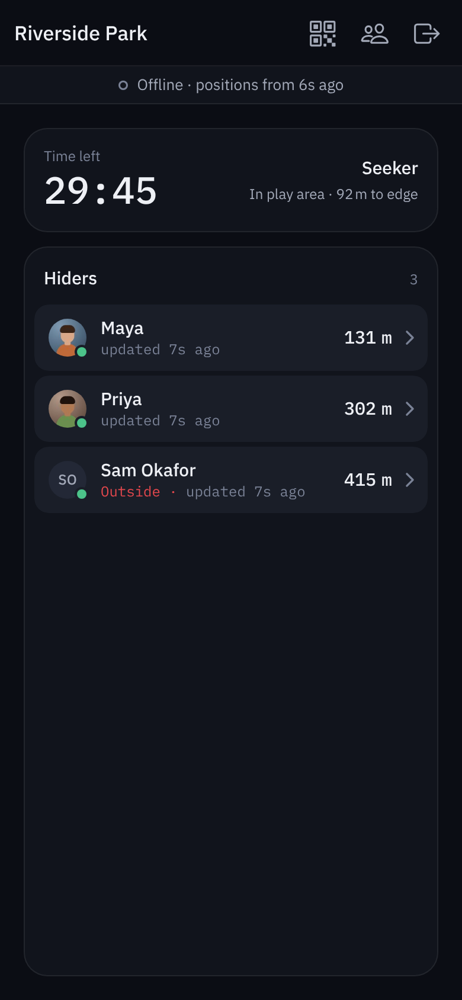</td>
    <td width="33%" valign="top">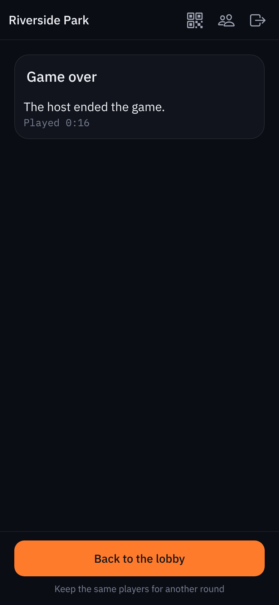</td>
    <td valign="top">
      <b>Built for patchy signal.</b> When the connection drops, the game keeps showing the last known positions with their age, reconnects on its own and resumes the same player. Nobody is kicked out by a dead zone.
      <br><br>
      <b>Game over.</b> The round ends when time runs out or the host ends it. The host takes everyone back to the lobby for another round with the same group.
    </td>
  </tr>
</table>

<sub>The map imagery in these screenshots is a generated stand-in; the app shows
OpenStreetMap streets. To refresh the images after a UI change, run
`npm run screenshots` (see <a href="#regenerating-the-walkthrough-screenshots">below</a>).</sub>

## Repo layout

- Repo root — React + Vite frontend (this used to be the whole repo)
- `server/` — Express + Socket.IO backend (merged in from the old ManhuntApi repo)

## Development

```bash
npm install                  # frontend deps
npm --prefix server install  # backend deps

npm run dev:server           # API + socket server on http://localhost:3001
npm run dev                  # Vite dev server (points at localhost:3001 via .env.development)

npm test                     # unit tests + socket-level server tests (needs the backend deps)
npm run lint
```

## How the protocol works

- `POST /manhunt-api/create-lobby` — the only REST endpoint; returns a `lobby_id`.
- Everything else happens over one Socket.IO connection (path
  `/manhunt-api/socket.io`), authenticated with `{ lobby_id, player_token }`:
  - No token → the server creates a player and returns a token in the `joined`
    event. The client stores it in localStorage.
  - Valid token → the server **resumes** that player (name, role, player_id
    preserved). This is what makes dead zones survivable: reconnecting after
    a dropout restores the same identity.
  - Client → server: `update-location`, `update-player`, `leave-lobby` (all acked).
  - Server → clients: `lobby-state` pushed to the lobby room on any change,
    throttled to 1/second per lobby. Includes each player's
    `location_last_updated` and `connected` flag so clients can show staleness.
- A player who disconnects is marked offline (not deleted) and kept for
  **5 minutes** before removal. After that, their token is rejected and the
  client offers the rejoin flow.

## Deployment

Two options:

1. **Single origin (simplest):** `npm run build`, then run `server/server.js`
   — it serves `dist/` itself when it exists. Build with `VITE_API_ORIGIN=""`
   (empty) so the client talks to its own origin.
2. **Split hosting:** host `dist/` anywhere, build with
   `VITE_API_ORIGIN=https://your-api-host`, and set the `ALLOWED_ORIGINS`
   env var (comma-separated) to your frontend origin.

Notes:
- Any reverse proxy in front of the server must forward WebSocket upgrade
  headers for `/manhunt-api/socket.io`. If it can't, Socket.IO automatically
  falls back to HTTP long-polling.
- Lobby state is in-memory only: restarting the server ends all live games.

## Play over the internet (Cloudflare Tunnel)

To play with friends who aren't on your Wi-Fi, expose the whole app (frontend,
API and websocket) through one public HTTPS URL. HTTPS is required: phones only
allow location, keep-screen-on, the camera and the iOS compass on secure pages.

Cloudflare Tunnel is free, has no bandwidth cap for an app like this, supports
WebSockets, and needs no router port forwarding.

```bash
npm run tunnel
```

This builds for single-origin, starts the server, opens a Cloudflare **quick
tunnel**, and prints a random `https://….trycloudflare.com` URL. Open it on
your phone, then use the in-app **Invite** button (QR code / link) to get
everyone else in. The URL changes every run and needs no Cloudflare account.

For a **permanent URL on your own domain**, create a named tunnel (below) and
run `TUNNEL_TOKEN=<token> PUBLIC_URL=https://manhunt.yourdomain.com npm run tunnel`.

Prerequisite: the `cloudflared` CLI
([downloads](https://developers.cloudflare.com/cloudflare-one/connections/connect-networks/downloads/)).

## Host on a Raspberry Pi

A Pi 5 (or a Pi 4) runs the whole app comfortably. The server serves the built
frontend itself, so there is one process and one port.

**1. Install Node 22 and the app**

```bash
curl -fsSL https://deb.nodesource.com/setup_22.x | sudo -E bash -
sudo apt-get install -y nodejs git

git clone https://github.com/That-Coder-Guy/ManhuntApp.git ~/ManhuntApp
cd ~/ManhuntApp
npm ci && npm --prefix server ci
npm run build:selfhost
```

**2. Run it on boot** with the included systemd unit (edit `User` and the
paths in it if your user isn't `pi`):

```bash
sudo cp deploy/manhunt.service /etc/systemd/system/
sudo systemctl daemon-reload
sudo systemctl enable --now manhunt
curl http://localhost:3001/manhunt-api/health   # {"status":"success"}
```

**3. Put it online with a named Cloudflare tunnel** (needs a domain on your
free Cloudflare account):

```bash
curl -L -o cloudflared.deb \
  https://github.com/cloudflare/cloudflared/releases/latest/download/cloudflared-linux-arm64.deb
sudo dpkg -i cloudflared.deb
```

In the Cloudflare dashboard: **Zero Trust → Networks → Tunnels → Create a
tunnel → Cloudflared**. Copy the install command it shows
(`sudo cloudflared service install <token>`) and run it on the Pi; that keeps
the tunnel running on boot. Then add a **public hostname** such as
`manhunt.yourdomain.com` with service `http://localhost:3001`.

No domain? `cloudflared tunnel --url http://localhost:3001` gives a free quick
tunnel instead, with a random URL that changes when it restarts.

**Updating**

```bash
cd ~/ManhuntApp && git pull
npm ci && npm --prefix server ci && npm run build:selfhost
sudo systemctl restart manhunt
```

Notes:
- Restarting the server ends live games (lobbies are in memory).
- A single-origin deployment works on any hostname; the origin allowlist only
  matters for split hosting.

Environment knobs (server):
- `PORT` — server port (default `3001`).
- `ALLOWED_ORIGINS` — extra comma-separated origins to allow (split hosting).
- `TRUST_ALL_ORIGINS=1` — allow any origin (disables the CORS allowlist).

## Hosting a game

Whoever creates a lobby is its host (the server gives the creator a secret
host key, kept with their session). In the pregame lobby everyone sets a
name, a small profile picture and a role; the host sets the rules and starts.

- **Play area**: the host draws a polygon on a map (tap to place corners, drag
  to move, tap a corner to remove it, tap a hollow handle to add one). Players
  outside it are flagged to everyone and told the way back. The inside test
  lives in `shared/geofence.js`, used by both the app and the server.
- **Time limit** (the hiders win when it runs out) and **head start** (seekers
  wait; hiders' positions stay hidden until it ends).
- The host can move players between roles, hand over the host role, remove
  players, end the game and start another round. The server enforces all of
  this, not just the UI.

Map tiles come from OpenStreetMap (free, attribution shown on the map). Tiles
already seen are cached by the service worker for patchy connections.

## Regenerating the walkthrough screenshots

```bash
npm i -D playwright && npx playwright install chromium   # once
npm run screenshots
```

`scripts/capture-walkthrough.mjs` builds the app, runs the real server on a
free port, plays a scripted five-player game in five browser "phones" and
writes every image above to `docs/walkthrough/`. Options:

- `STUB_TILES=1` draws a stand-in street map instead of loading OpenStreetMap
  (for machines that can't reach it).
- `--no-build` reuses the current `dist/`.

## Compass / device orientation (Android & iOS)

The compass arrow works across platforms via `src/hooks/useCompassHeading.js`
(pure math in `src/utils/orientation.js`, unit-tested with `npm test`):

- **iOS Safari**: uses `webkitCompassHeading` (a true clockwise heading) behind
  the iOS tap-to-grant permission prompt.
- **Android Chrome / Samsung Internet**: uses `deviceorientationabsolute`.
  Spec `alpha` is *counterclockwise* and only meaningful with tilt taken into
  account, so the heading is computed as the horizontal projection of the
  device's top axis, then screen-rotation compensated and smoothed.
- **Firefox Android**: falls back to `deviceorientation` events flagged
  `absolute: true`.
- Relative orientation events (arbitrary, drifting zero) are never used.
- Devices with no magnetometer are detected at runtime and get a cardinal
  direction fallback ("Head NE" + distance) instead of a dead arrow.

Requirements: sensors only work over **HTTPS**, and any proxy must not send a
`Permissions-Policy` header that blocks `accelerometer`, `gyroscope`, or
`magnetometer`.
