# Manhunt

Real-world hide and seek. Players join a lobby on their phones, share live GPS
positions, and seekers get distance readouts and a compass arrow pointing at
their chosen hider.

Built to keep working on **spotty internet**: the client and server talk over
Socket.IO with automatic reconnection, players who drop offline keep their
identity for 5 minutes and resume seamlessly, stale positions are labeled
instead of silently shown as live, and a service worker keeps the app shell
loading without connectivity.

<p align="center">
  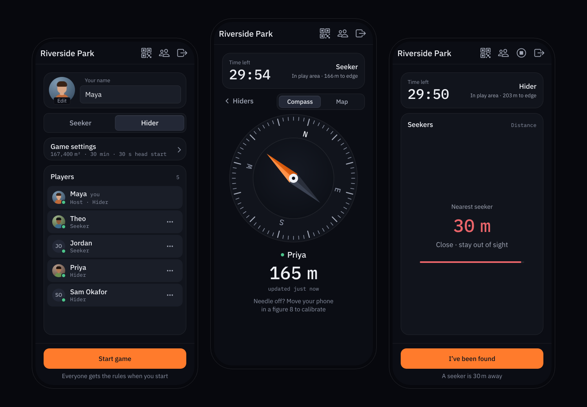
</p>

## Walkthrough

One round, start to finish, as five friends play it. Every screen below is the
real app, captured at phone size (390 × 844) from a scripted game.

### 1. Start a lobby

<table>
  <tr>
    <td width="33%" valign="top">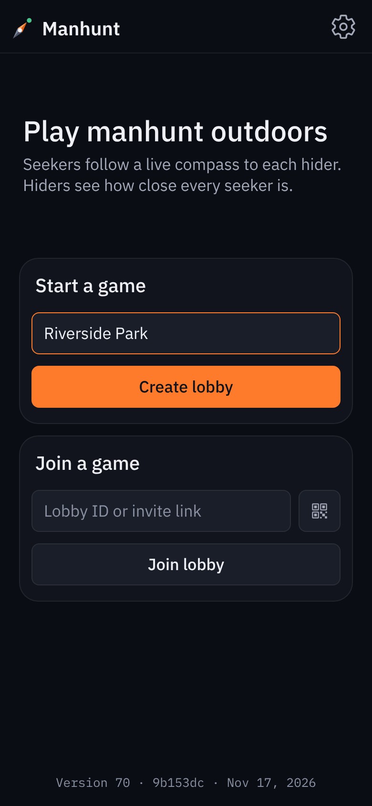</td>
    <td width="33%" valign="top">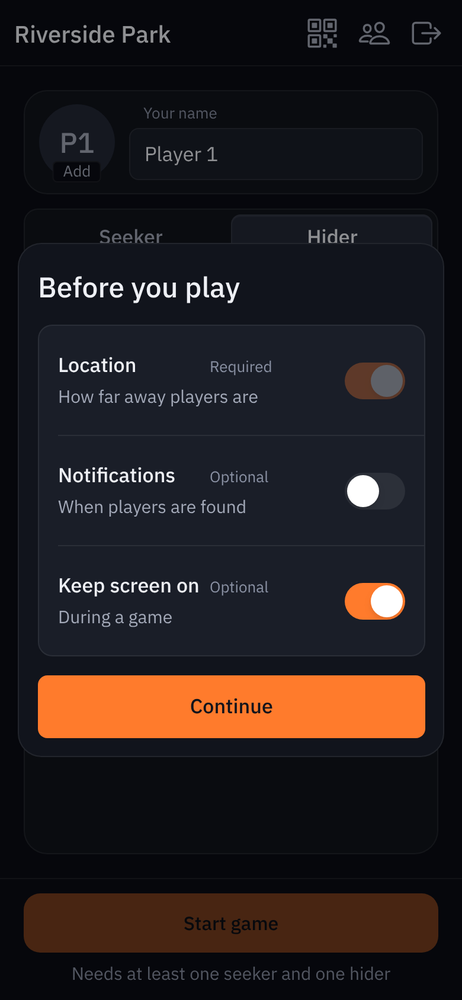</td>
    <td width="33%" valign="top">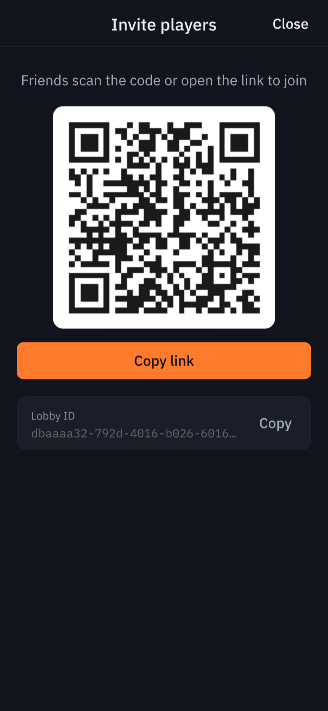</td>
  </tr>
  <tr>
    <td valign="top"><b>Create or join.</b> Name the lobby and tap <i>Create lobby</i>. Friends join with the lobby ID, a pasted invite link, or the QR button, which scans an invite with the camera.</td>
    <td valign="top"><b>Before you play.</b> In the browser, entering a lobby asks for what the game uses: location and, on an iPhone, the compass are required; notifications are optional. <b>Leave lobby</b> is the way out for anyone who'd rather not. The installed app also offers the switches once, when it first opens, where they can be put off. They're on the Settings page afterwards too, where one that's on can only be turned off in the phone's own settings.</td>
    <td valign="top"><b>Invite.</b> <i>Invite players</i>, in the top bar's <b>···</b> menu, shows a code anyone can scan with their phone camera to land straight in the lobby.</td>
  </tr>
</table>

### 2. Gather in the lobby

<table>
  <tr>
    <td width="33%" valign="top">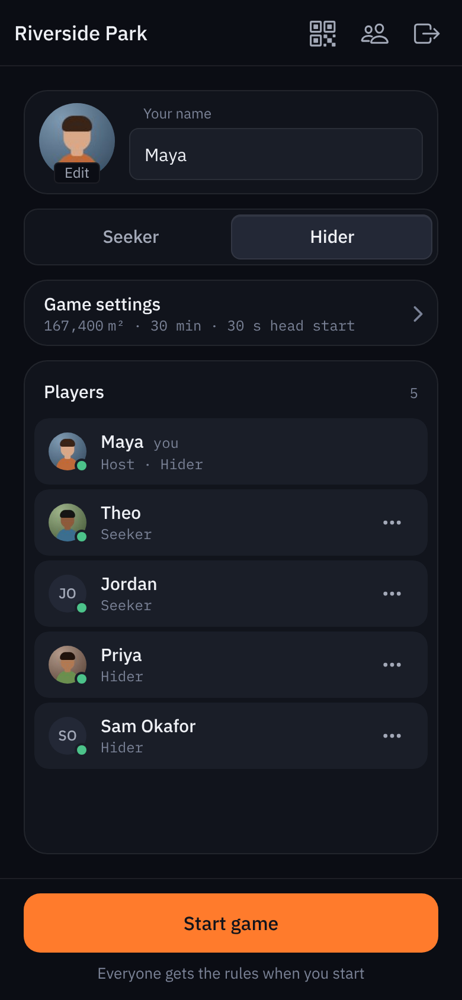</td>
    <td width="33%" valign="top">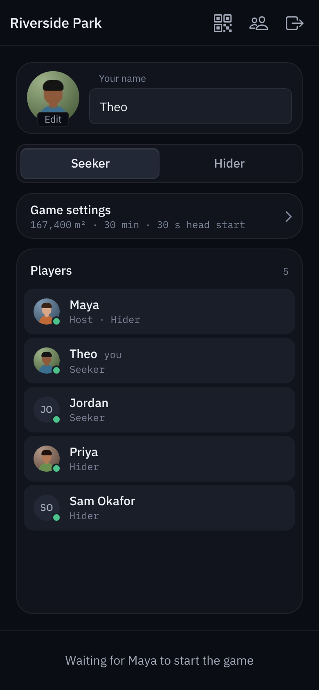</td>
    <td width="33%" valign="top">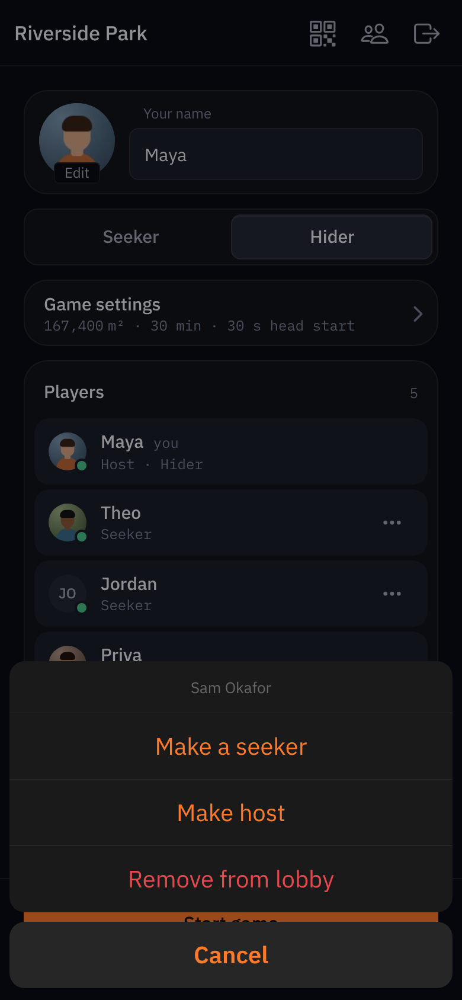</td>
  </tr>
  <tr>
    <td valign="top"><b>Everyone sets up.</b> A name, a small profile picture (tap the circle) and a role. The green dot means a player is connected. Only the host gets <i>Start game</i>, and only once there is a seeker and a hider.</td>
    <td valign="top"><b>Guests wait for the host.</b> They see the same rules and players, read-only.</td>
    <td valign="top"><b>The host is in charge.</b> The ••• menu on any player switches their role, hands over the host role, or removes them. The server enforces it, not just the app.</td>
  </tr>
</table>

### 3. Set the rules

<table>
  <tr>
    <td width="33%" valign="top">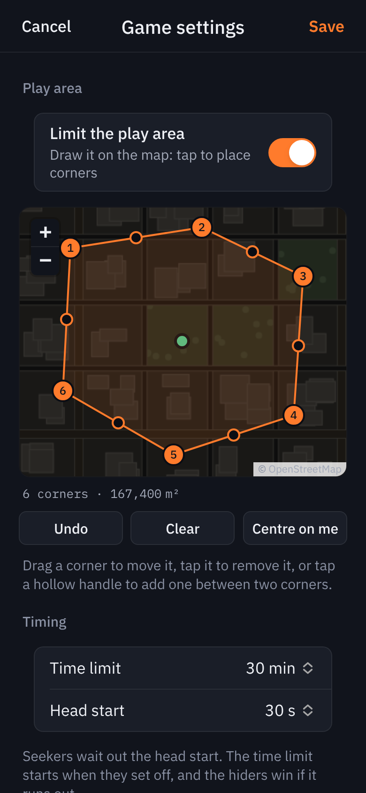</td>
    <td valign="top">
      <b>Draw the play area.</b> The host taps the map to place corners. Drag a corner to move it, tap it to remove it, or tap a hollow handle to add one between two corners. The area updates live, and a shape whose edges cross can't be saved.
      <br><br>
      <b>Time limit and head start.</b> Seekers wait out the head start while hiders' positions stay hidden. The clock starts when seekers set off; the hiders win if it runs out.
      <br><br>
      <b>Found range.</b> How close a seeker must get before a hider can declare themselves found (50 m by default).
      <br><br>
      <b>What hiders see.</b> The distance to the nearest seeker (the default), only an alert when a seeker comes within a set distance, or nothing at all.
      <br><br>
      <b>What seekers see.</b> A hider who stands still is only shown as somewhere within 25 m (the host can change the distance, or choose <i>Exactly</i>). The faster a hider moves, the smaller that gets, and anyone going faster than an 11-minute mile is seen exactly.
      <br><br>
      <b>Jamming.</b> Each hider has a jammer that makes them vanish from the seekers for a while: off the seekers' list and map, with no position sent at all. By default a jam lasts 60 seconds and takes 15 minutes to charge, counted from when the seekers set off and again after each jam. The host can change both times, or turn jamming off.
      <br><br>
      Everyone else can open the same sheet to see the rules and the area, but can't change them.
    </td>
  </tr>
</table>

### 4. Seek

<table>
  <tr>
    <td width="33%" valign="top">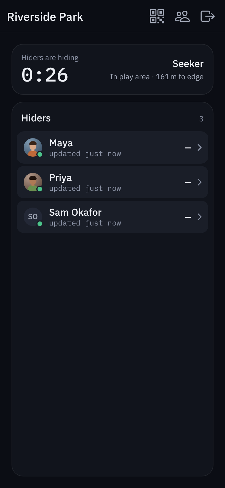</td>
    <td width="33%" valign="top">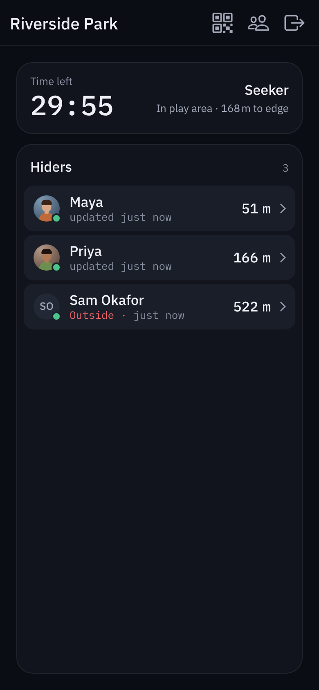</td>
    <td width="33%" valign="top">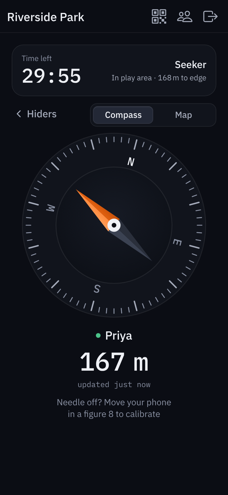</td>
  </tr>
  <tr>
    <td valign="top"><b>Head start.</b> Seekers count down while hiders scatter. Hider positions are withheld by the server until it ends.</td>
    <td valign="top"><b>The hunt.</b> Every hider with their distance and how fresh their position is. Anyone who leaves the play area is marked <i>Outside</i>.</td>
    <td valign="top"><b>The compass.</b> Tap a hider: the needle points at them, the dial turns so N stays north, and the distance updates as you move.</td>
  </tr>
  <tr>
    <td width="33%" valign="top">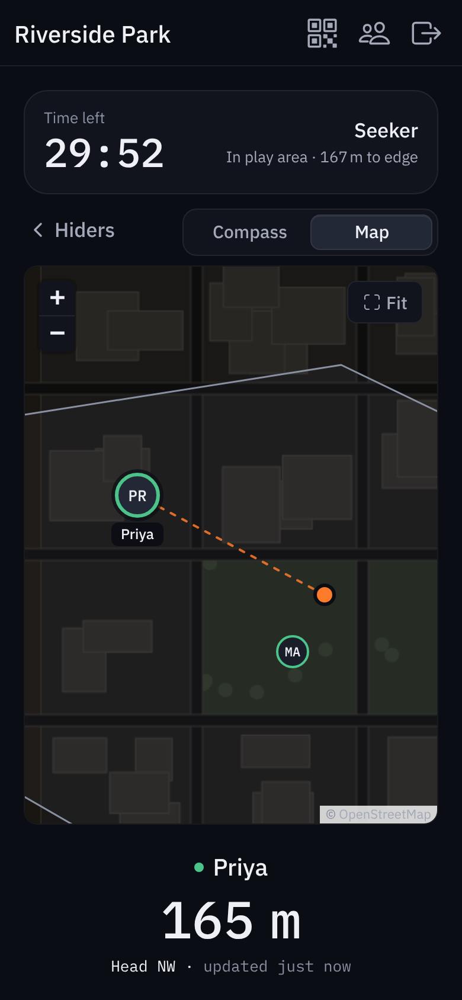</td>
    <td colspan="2" valign="top"><b>Or the map.</b> Switch from <i>Compass</i> to <i>Map</i> to track on a street map instead: you, a dashed line to the hider you're after, the other hiders (tap one to track them) and the play area. North is up until you press the align button under <i>Fit</i>: then, like the dial, the map turns with your phone so the way you face is up (names and buttons stay upright), and pressing it again puts north back up. It frames you both, stays put while you pan and zoom, and <i>Fit</i> brings you both back into view. The crosshair button centres the map on you, facing the way you face, and keeps it on you as you walk until you drag it or tap <i>Fit</i>. Each phone remembers which one its seeker prefers.</td>
  </tr>
</table>

### 5. Hide

<table>
  <tr>
    <td width="33%" valign="top">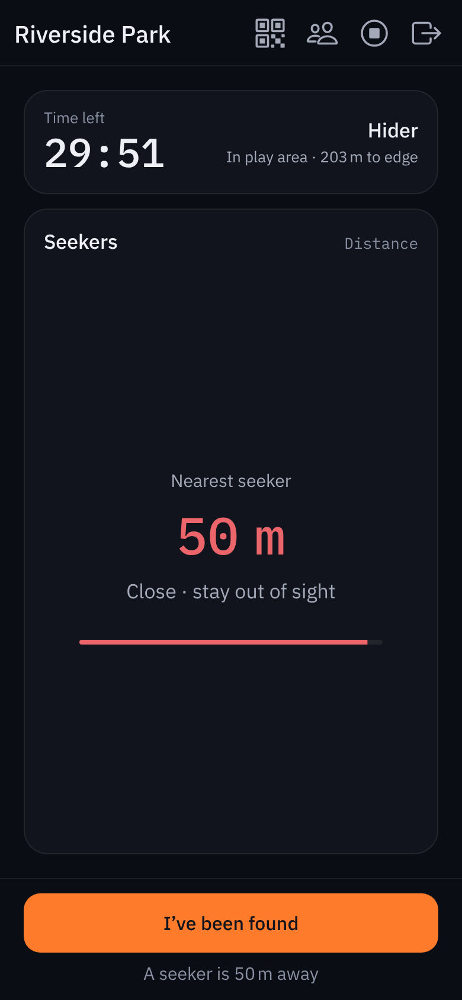</td>
    <td width="33%" valign="top">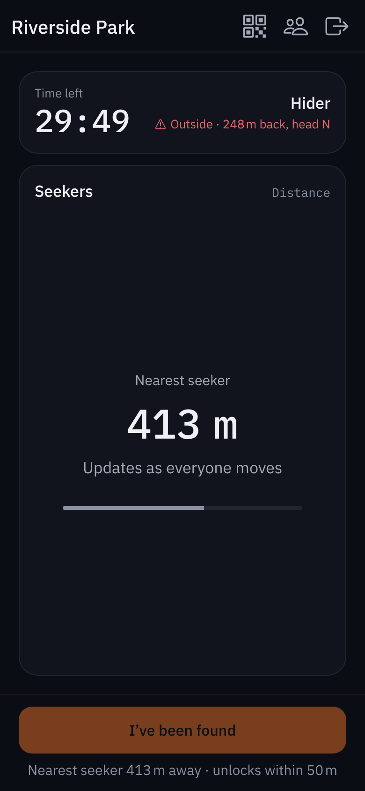</td>
    <td width="33%" valign="top">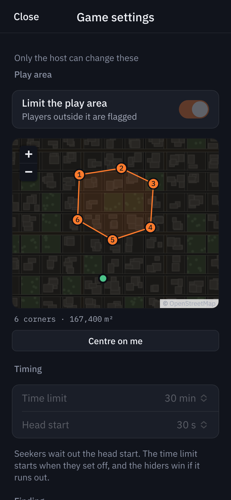</td>
  </tr>
  <tr>
    <td valign="top"><b>Watch them close in.</b> By default hiders see how far away the nearest seeker is (not who, or which way), with a bar that fills as they get closer and turns red under 100 m. Once a seeker is within the found range (50 m unless the host changes it), <b>I’ve been found</b> unlocks: tap it and you join the seekers. If the host chose the nearby alert, hiders only see <i>Seeker nearby</i> or <i>All clear</i>; with seeker info off, nothing. In those games the button is always there, and the server checks the distance.</td>
    <td valign="top"><b>Stay in bounds.</b> Step outside the area and the status card says how far back it is and which way to go.<br><br><b>Find each other.</b> The <b>Map</b> tab shows you and the other hiders, as the seekers see them: a hider who is caught joins the seekers, so hiders are told no more about each other than the seekers are. No seeker is ever on it.</td>
    <td valign="top"><b>See the area.</b> Tap the status card to open the map, framed to show both the area and you.</td>
  </tr>
</table>

### 6. Weak signal, and the end of the round

<table>
  <tr>
    <td width="33%" valign="top">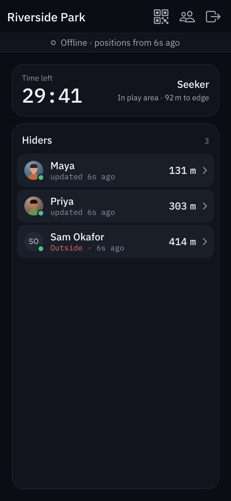</td>
    <td width="33%" valign="top">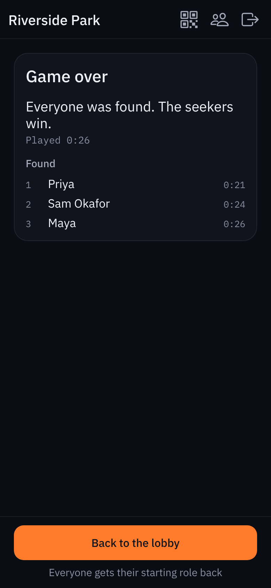</td>
    <td valign="top">
      <b>Built for patchy signal.</b> When the connection drops, the game keeps showing the last known positions with their age, reconnects on its own and resumes the same player. Nobody is kicked out by a dead zone.
      <br><br>
      <b>Game over.</b> The round ends when every hider is found, time runs out, or the host ends it. Everyone sees the result, and who was found when, until the host takes the group back to the lobby; only the host has that button. Everyone gets their starting role back.
    </td>
  </tr>
</table>

<sub>The map imagery in these screenshots is a generated stand-in; the app shows
OpenStreetMap streets. To refresh the images after a UI change, run
`npm run screenshots` (see <a href="#regenerating-the-walkthrough-screenshots">below</a>).</sub>

## Repo layout

- Repo root — React + Vite frontend (this used to be the whole repo)
- `server/` — Express + Socket.IO backend (merged in from the old ManhuntApi repo)
- `shared/` — code both sides use (play-area geometry)
- `tests/` — unit and server tests; `tests/e2e/` holds the browser tests
- `scripts/` — setting up and deploying a server, the walkthrough screenshots, and the simulator (`npm run simulate`)
- `docs/vault/` — project notes as an Obsidian vault (open the folder as a vault; start at `Manhunt.md`)

## Development

```bash
npm install                  # frontend deps
npm --prefix server install  # backend deps

npm run dev:server           # API + socket server on http://localhost:3001
npm run dev                  # Vite dev server (points at localhost:3001 via .env.development)

npm test                     # unit tests + socket-level server tests (needs the backend deps)
npm run lint
```

### Browser tests

`tests/e2e/` plays the real app in headless Chromium against a real game
server, one browser "phone" per player:

```bash
npm i -D playwright && npx playwright install chromium   # once

npm run test:e2e                    # every suite, pass/fail (about 6 minutes)
npm run test:e2e -- found camera    # just those (names from tests/e2e/suites/)
npm run audit:ui                    # layout, legibility and text-position audits
```

The runner builds the app (pass `--no-build` to reuse `dist/`) and starts the
game server itself, with notifications recorded to a file instead of sent and
map tiles stubbed, so it needs no internet. Screenshots land in
`tests/e2e/output/`. The audits report notes to read rather than pass or fail;
a few are known and harmless (the selected segment's text measured against the
wrong layer, back buttons' text sitting beside their chevron, the invite's
cut-off lobby ID). Things the suites can't check, because a desktop browser
can't do them: real push delivery, iPhone shake-to-undo, and a real compass.

### Simulator

Up to four phones side by side in one browser window, each running the real
web app, in a game that starts by itself:

```bash
npm run simulate                  # build the app, start, open http://localhost:3210/simulator
npm run simulate -- --no-build    # reuse dist/
npm run simulate -- --no-open     # don't open the browser
```

The first phone is the host and a seeker; **Phones** and **Seekers** in the
bar change the numbers, and **New game** starts again in a new lobby. Every
phone stands, walks or runs at random within 350 m of the middle
(`?lat=..&lng=..` in the address moves the middle), and the panel on the right
shows where each one really is, to set against what the phones are shown.
Each phone can be used like a real one: open **Abilities** and tap **Jam**, open the map, send a
chat message. **Reload** under a phone's name reloads just that phone.

It runs its own game server on this computer only, with notifications off.
Jammers charge in 30 seconds there, not 15 minutes; every other setting is the
default. The app isn't changed for it: `scripts/simulate.mjs` adds one script
to the page it serves (`scripts/simulator/phone.mjs`), which stands in for
each phone's location and compass and keeps their saved data apart.

## How the protocol works

- `POST /manhunt-api/create-lobby` — the only REST endpoint; returns a `lobby_id`.
- Everything else happens over one Socket.IO connection (path
  `/manhunt-api/socket.io`), authenticated with `{ lobby_id, player_token }`:
  - No token → the server creates a player and returns a token in the `joined`
    event. The client stores it in localStorage.
  - Valid token → the server **resumes** that player (name, role, player_id
    preserved). This is what makes dead zones survivable: reconnecting after
    a dropout restores the same identity.
  - Client → server: `update-location`, `update-player`, `leave-lobby` (all acked).
    `jam` starts a hider's jam, if it is charged; the server answers with
    why not otherwise. `chat-send` adds a message to the lobby's chat: up
    to 280 characters, a picture (`image: { data, width, height }`, a JPEG
    or WebP of at most 72 KB as bytes), or both. `channel` says who it's
    for: `all` (the default), or the sender's own side, `seekers` or
    `hiders`.
    `push-subscribe` hands the server the phone's Web Push subscription (or
    `null`), and `set-visibility` says whether the app is on screen; the
    server pushes "found" notices only to players who aren't looking.
  - Server → clients: `lobby-state` pushed to the lobby room on any change,
    throttled to 1/second per lobby. During a game each player gets their own
    copy: a hider's has no seeker's position (of the other hiders it has
    just what the seekers have), and instead a `seeker_info`
    (`distance`, `nearby` or `none`, as the host set it) and a `jam` saying
    where their own jammer stands. Includes each player's
    `location_last_updated` and `connected` flag so clients can show staleness,
    and `jammed_until` for a hider who is jamming: everyone else's copy then
    carries the position that hider had when the jam started. A hider's
    position in everyone else's copy is only as exact as the hider is fast:
    `uncertainty_m` says how far from the given point they may be (0 when it
    is their real position).
  - The chat: `chat-history` (the lobby's last 200 messages) on every
    connection, then `chat-message` to everyone as each is sent. A message
    for one side goes only to that side's phones, and a player is given
    only what their side said since they came onto it: `chat-history` is
    sent again, without the rest, whenever a player changes sides. A message
    with a picture carries only its ID, type and size; the picture is
    fetched from `GET /manhunt-api/chat-image/<lobby>/<id>` when it's shown.
- A player who disconnects is marked offline (not deleted) and kept for
  **5 minutes** before removal. After that, their token is rejected and the
  client offers the rejoin flow.

## Deployment

Two options:

1. **Single origin (simplest):** `npm run build`, then run `server/server.js`
   — it serves `dist/` itself when it exists. Build with `VITE_API_ORIGIN=""`
   (empty) so the client talks to its own origin.
2. **Split hosting:** host `dist/` anywhere, build with
   `VITE_API_ORIGIN=https://your-api-host`, and set the `ALLOWED_ORIGINS`
   env var (comma-separated) to your frontend origin.

Notes:
- Any reverse proxy in front of the server must forward WebSocket upgrade
  headers for `/manhunt-api/socket.io`. If it can't, Socket.IO automatically
  falls back to HTTP long-polling.
- Lobby state is in-memory only: restarting the server ends all live games.
- The server compresses the app as it serves it (the main script goes out at
  about a quarter of its size), so nothing in front of it has to.

## Play over the internet (Cloudflare Tunnel)

To play with friends who aren't on your Wi-Fi, expose the whole app (frontend,
API and websocket) through one public HTTPS URL. HTTPS is required: phones only
allow location, keep-screen-on, the camera and the iOS compass on secure pages.

Cloudflare Tunnel is free, has no bandwidth cap for an app like this, supports
WebSockets, and needs no router port forwarding.

```bash
npm run tunnel
```

This builds for single-origin, starts the server, opens a Cloudflare **quick
tunnel**, and prints a random `https://….trycloudflare.com` URL. Open it on
your phone, then use the in-app **Invite** button (QR code / link) to get
everyone else in. The URL changes every run and needs no Cloudflare account.

To keep the server running on an always-on machine such as a Raspberry Pi,
with the same kind of trycloudflare.com address or your own domain, use
`scripts/setup-server.sh` ([below](#set-up-the-server-with-cloudflare-raspberry-pi-or-any-linux-box)).
For a fixed address with no machine of your own, see
[Host it in the cloud](#host-it-in-the-cloud-flyio).

Prerequisite: the `cloudflared` CLI
([downloads](https://developers.cloudflare.com/cloudflare-one/connections/connect-networks/downloads/)).

## Host it in the cloud (Fly.io)

For an address that never changes, and no machine of your own to keep
running, `npm run deploy:fly` puts the whole app (frontend, API and
websocket) on [Fly.io](https://fly.io): one small machine that is always on,
at `https://your-name.fly.dev`. Fly.io charges for the machine (a couple of
dollars a month for this size when this was written; it has no free plan, so
check [its pricing](https://fly.io/pricing)).

### What you need

- A Fly.io account, with a payment card on it. Without one the account is a
  trial, and a trial's machines are stopped after five minutes.
- The Fly.io CLI ([install](https://fly.io/docs/flyctl/install/)). On Windows:

  ```powershell
  pwsh -Command "iwr https://fly.io/install.ps1 -useb | iex"
  ```

- This repository, with the server's packages installed (the script uses one
  of them to make the push keys): `npm --prefix server ci`.

### Run it

```bash
fly auth signup                          # or: fly auth login
npm run deploy:fly -- --app your-name    # your-name becomes the address
```

The name must be one nobody else on Fly.io has taken. The script
(`scripts/deploy-fly.mjs`):

1. creates the app on your account and writes its name into `fly.toml`
   (commit that change, so later deploys know it);
2. makes the key pair that signs push notifications and stores it as Fly.io
   secrets, once. They have to outlive every deploy, and the machine's own
   disk doesn't;
3. builds the image from the `Dockerfile` on Fly.io's builders (no Docker
   needed here) and deploys it as a **single** machine. Games live in the
   server's memory, so two machines would be two separate servers;
4. prints the address. The iPhone and Android apps have the game's address
   built in; if yours is a different one, change it there (their READMEs say
   where).

`fly.toml` holds the rest: the region (`primary_region`, Dallas by default;
pick the one nearest your players), the machine's size, and that it is never
stopped for being idle.

### Update

```bash
git pull && npm run deploy:fly
```

Deploying restarts the server, which ends games in progress, so do it
between rounds. The version at the foot of the landing page tells you it
went through; the image has no git checkout, so the script reads the version
and passes it in.

### Check on it, or remove it

```bash
fly status                 # the machine should be "started"
fly logs                   # what the server says
fly apps destroy your-name # remove it (and stop being charged)
```

The `Dockerfile` isn't tied to Fly.io: any host that runs a container and
forwards WebSockets can use it. The server listens on `$PORT`; pass the
build arguments `MANHUNT_BUILD`, `MANHUNT_COMMIT` and `MANHUNT_COMMIT_DATE`
to give it a version, and set `VAPID_PUBLIC_KEY` / `VAPID_PRIVATE_KEY` so
the push keys survive restarts.

## Set up the server with Cloudflare (Raspberry Pi or any Linux box)

`scripts/setup-server.sh` turns a fresh Raspberry Pi (or any Debian/Ubuntu
machine) into a server anyone can reach over HTTPS. It installs Node 22 if
needed, builds the app, and runs it as a service that starts on boot. It also
installs `cloudflared` and connects a Cloudflare Tunnel. A Pi 4 or 5 runs
the whole app comfortably. Nothing on your router needs changing, and the
tunnel is free with no bandwidth cap for an app like this.

There are two kinds of address:

| | Cloudflare's address (`--quick`) | Your own domain (`--hostname`) |
| --- | --- | --- |
| Looks like | `https://calm-river-otter.trycloudflare.com` | `https://manhunt.yourdomain.com` |
| Needs | Nothing: no account, no domain | A free Cloudflare account with a domain on it |
| Address | Changes whenever the tunnel restarts (a reboot, say) | Fixed |

### What you need

- The Pi (Raspberry Pi OS 64-bit) or another Debian/Ubuntu machine, online.
- For your own domain only: a free Cloudflare account with the domain added
  under **Add a site** (point your registrar's nameservers at Cloudflare), or
  bought through Cloudflare Registrar.

### Run it: Cloudflare's address

```bash
sudo apt-get update && sudo apt-get install -y git
git clone https://github.com/That-Coder-Guy/ManhuntApp.git ~/ManhuntApp
cd ~/ManhuntApp
scripts/setup-server.sh --quick
```

Run it as your normal user; it asks for `sudo` when it needs to. At the end
it prints the address:

```
  Play at:  https://calm-river-otter.trycloudflare.com
```

Open it on your phone and start a lobby. The in-app **Invite** QR code and
link use whatever address you opened, so friends join through the same one.

The address stays the same while the tunnel keeps running, but Cloudflare
hands out a new one each time it restarts: after a reboot, a power cut, or
re-running the script with a different `--port`. Re-running the script with
nothing changed leaves the tunnel, and its address, alone. To see the current
address at any time:

```bash
scripts/setup-server.sh --url
```

Cloudflare offers quick tunnels without any uptime guarantee. They are
reliable enough for games with friends; for something permanent, use a domain.

### Run it: your own domain

```bash
scripts/setup-server.sh --hostname manhunt.yourdomain.com
```

The first run prints a Cloudflare login link. Open it on any device (your
phone is fine) and pick the domain. The script then creates a tunnel called
`manhunt`, adds the DNS record for the hostname, starts both services, and
checks that `https://manhunt.yourdomain.com` answers.

Prefer the dashboard? Create the tunnel there (**Zero Trust → Networks →
Tunnels → Create a tunnel → Cloudflared**), give it a public hostname with
service `http://localhost:3001`, copy the token from the install command it
shows, and run:

```bash
scripts/setup-server.sh --token <TOKEN> --hostname manhunt.yourdomain.com
```

(`--hostname` is only used here to check the address works.) The token is
stored in `/etc/cloudflared/manhunt-tunnel.env`, readable by root only.

Add `--dry-run` to any command to see what it would do without changing
anything; `--help` lists every option (`--port`, `--tunnel-name`,
`--no-tunnel`, `--no-build`). You can switch between kinds of address later
by re-running with `--quick` or `--hostname`.

### Update

```bash
cd ~/ManhuntApp && git pull && scripts/setup-server.sh
```

To confirm an update went through, compare the version at the foot of the
landing page (build number · commit · date) with the one the script prints
at the end, or with `git log -1`. If the server is on a different update
from the copy of the app your phone has, the landing page says so in red;
reloading the page picks up the new app.

Phones pick updates up by themselves, including the app installed to the
Home Screen: it looks for a new version when it opens, whenever you switch
back to it, and every half hour. A new version never interrupts a game:

- On the landing page it applies straight away (unless you're typing; then
  the version line offers **Reload now**).
- In a lobby or on the results screen, a strip offers **Reload**.
- During a game it waits until the game is over.

Re-running keeps the port, allowed origins and tunnel from last time,
rebuilds, and restarts the app. The tunnel is only restarted if its settings
changed, so a quick tunnel keeps its address. Restarting the app ends live
games (lobbies are in memory), so update between rounds.

### Check on it

```bash
systemctl status manhunt manhunt-tunnel        # both should be "active (running)"
journalctl -u manhunt -f                       # app logs
journalctl -u manhunt-tunnel -f                # tunnel logs
scripts/setup-server.sh --url                  # the public address
curl https://<your-address>/manhunt-api/health   # {"status":"success"}
```

- **Error 1033 or 530** from Cloudflare: the tunnel isn't connected; check
  `journalctl -u manhunt-tunnel`.
- **Error 502**: the tunnel is up but the app isn't; check `journalctl -u manhunt`.
- **Not resolving yet**: a brand-new DNS record or quick-tunnel address can
  take a minute or two.

### Just one game, no server

`npm run tunnel` (on any machine with `cloudflared` installed) builds, starts
the server and opens a quick tunnel in the foreground, without installing any
services. It prints the `https://….trycloudflare.com` address, and Ctrl-C
stops everything.

### Remove it

```bash
sudo systemctl disable --now manhunt manhunt-tunnel
sudo rm /etc/systemd/system/manhunt.service /etc/systemd/system/manhunt-tunnel.service
sudo rm -f /etc/cloudflared/manhunt-tunnel.*   # tunnel config/token
sudo systemctl daemon-reload
cloudflared tunnel delete manhunt              # if the script created it
```

Doing it by hand instead: `deploy/manhunt.service` is a plain systemd unit for
the app. Server settings, as environment variables:

- `PORT` — server port (default `3001`).
- `ALLOWED_ORIGINS` — extra comma-separated origins to allow (split hosting).
- `TRUST_ALL_ORIGINS=1` — allow any origin (disables the CORS allowlist).
- `VAPID_PUBLIC_KEY` / `VAPID_PRIVATE_KEY` — the key pair that signs push
  notifications. Without them the server makes one on first start and keeps
  it in `server/.vapid-keys.json` (not committed; keep it, since phones'
  subscriptions belong to that key). `VAPID_SUBJECT` sets the contact URL sent
  with pushes (defaults to this repository).

## Hosting a game

Whoever creates a lobby is its host (the server gives the creator a secret
host key, kept with their session). In the pregame lobby everyone sets a
name, a small profile picture and a role; the host sets the rules and starts.

- **Play area**: the host draws a polygon on a map (tap to place corners, drag
  to move, tap a corner to remove it, tap a hollow handle to add one). Players
  outside it are flagged to everyone and told the way back. The inside test
  lives in `shared/geofence.js`, used by both the app and the server.
- **Time limit** (the hiders win when it runs out) and **head start** (seekers
  wait; hiders' positions stay hidden until it ends).
- **Found range** (50 m by default, 10–300 m): once a seeker is this close, a
  hider can tap **I've been found** and joins the seekers. The server checks
  the distance itself, against seekers' positions from the last two minutes,
  and not during the head start. When the last hider is found the seekers win
  and the game ends for everyone.
- **What hiders see** about the seekers: the distance to the nearest one (the
  default), only an alert when one comes within a chosen distance (never
  more than the found range, so 50 m by default), or nothing. The server enforces it: during a game a
  hider's phone is never sent a seeker's position, only what this setting
  allows, worked out on the server.
- **What seekers see** of a hider depends on the hider's speed: standing
  still, only an area (within 25 m by default; the host can change it or
  choose *Exactly*); the radius halves as the speed doubles, and faster
  than an 11-minute mile (2.44 m/s) it is the exact spot, within a few
  seconds of breaking into a run. The server sends seekers the middle of a
  circle that stays put while the hider is in it, and the hider may be
  anywhere in that circle, so there is nothing to average.
- **Jamming**: each hider's jammer makes them vanish for the seekers (60
  seconds by default, 15 minutes to charge; the host can change both or turn
  it off). While it runs the server sends no one else any position for that
  hider, so they are gone from the seekers' list, compass and map, and come
  back when it ends.
- **Hiders see each other** on the **Map** tab, as the seekers see them and
  no more exactly: a hider who is caught joins the seekers, and shouldn't
  arrive knowing better than them where the rest are.
- **Chat**: the speech-bubble button opens one conversation for everyone in
  the lobby, both sides, before, during and after a game, and beside it a
  chat for your own side that the other side is never sent. Changing sides
  (a hider who is caught, a role changed in the lobby) leaves the old
  side's chat behind and starts the new side's from that moment, so
  nobody reads what a side said before they were on it. A message can
  carry a picture: the phone shrinks it to at most 1280 pixels and about
  60 KB before sending (WebP where the browser can make one, else JPEG),
  and tapping one in the conversation opens it full screen. A lobby keeps
  its newest 40 pictures.
- **Steady hider positions**: GPS indoors scatters tens of metres. A
  hider's phone weighs each fix by the accuracy it reports
  (`src/utils/positionFilter.js`): with poor fixes it averages over many (a
  ~40 m scatter shows as ~10 m, and stops jumping around), with good ones it
  follows straight away, so walking out of a building shows at once. Only
  the jitter averages out; a building can still shift the whole scatter.
- **Permissions**: **Before you play** asks for them on entering a lobby,
  and the lobby can't be entered without location and, on an iPhone, the
  compass (notifications are optional). **Leave lobby** is the way out for
  anyone who'd rather not allow them. The browser shows it on the way into
  every lobby. The installed app offers the same switches on a permissions
  page when it first opens, plus an optional **Camera** switch (allowing it
  only means scanning a join code doesn't ask first); that page can be put
  off with **Not now**, and the app opens without any of it. It then sees
  **Before you play** at a lobby only if something a game needs is still
  missing. The switches are on the Settings page too. A switch asks; it
  can't take a permission back or undo a refusal, so once allowed it locks,
  and a blocked one says where it can be allowed: the phone's own settings
  (the native apps have an **Open settings** button that says what Manhunt
  needs there and opens them). Tapping a switch that's on brings up a popup
  saying it can only be turned off in those settings; in the native apps the
  popup's **Open settings** goes straight there.
- **Settings** (the gear on the home page) shows the permission switches
  again (what's allowed, and a switch for what isn't yet), and holds how the
  app looks and behaves: **Text size**, **Reduce motion**, and, where a page
  can do it, **Keep screen on** during a game (the native apps don't need it:
  they carry on with the screen off).
- **Notifications**: anyone who turns them on gets one
  when another player is found ("Maya was found · 1 hider left"), even with
  the phone locked. Players looking at the app already see it on screen, so
  they aren't sent one. Tapping it opens the lobby. A player whose app has
  been closed (or whose locked phone dropped the connection) is taken out of
  the lobby after 5 minutes; with about 2 minutes left they get a reminder
  ("Still playing in Riverside Park?"), and opening the app keeps them in. On an iPhone they need iOS
  16.4 or later and the app added to the Home Screen (Share → Add to Home
  Screen).
- **Add to Home Screen**: on a phone's first visit, a popup offers to install
  the app: Chrome's own Install button where the browser has one, otherwise
  the steps (Share → Add to Home Screen on an iPhone, the browser menu on
  Android). It's shown once, and never in the installed app.
- The host can move players between roles, hand over the host role, remove
  players, end the game and start another round. The server enforces all of
  this, not just the UI.

Map tiles come from OpenStreetMap (free, attribution shown on the map). Tiles
already seen are cached by the service worker for patchy connections.

## Regenerating the walkthrough screenshots

```bash
npm i -D playwright && npx playwright install chromium   # once
npm run screenshots
```

`scripts/capture-walkthrough.mjs` builds the app, runs the real server on a
free port, plays a scripted five-player game in five browser "phones" and
writes every image above to `docs/walkthrough/`. Options:

- `STUB_TILES=1` draws a stand-in street map instead of loading OpenStreetMap
  (for machines that can't reach it).
- `--no-build` reuses the current `dist/`.

## App icon

The icon is the in-game compass needle pointing at a player's green fix dot.
Its source is `public/icon.svg`; `public/favicon.svg` is a simplified version
for browser tabs, without the ring that disappears at that size. After editing
either, render the PNGs (manifest icons, the iOS Home Screen icon and the
favicon) with:

```bash
npm run icons
```

## Compass / device orientation (Android & iOS)

The compass arrow works across platforms via `src/hooks/useCompassHeading.js`
(pure math in `src/utils/orientation.js`, unit-tested with `npm test`):

- **iOS Safari**: uses `webkitCompassHeading` (a true clockwise heading) behind
  the iOS tap-to-grant permission prompt.
- **Android Chrome / Samsung Internet**: uses `deviceorientationabsolute`.
  Spec `alpha` is *counterclockwise* and only meaningful with tilt taken into
  account, so the heading is computed as the horizontal projection of the
  device's top axis, then screen-rotation compensated and smoothed.
- **Firefox Android**: falls back to `deviceorientation` events flagged
  `absolute: true`.
- Relative orientation events (arbitrary, drifting zero) are never used.
- Devices with no magnetometer are detected at runtime and get a cardinal
  direction fallback ("Head NE" + distance) instead of a dead arrow.

Requirements: sensors only work over **HTTPS**, and any proxy must not send a
`Permissions-Policy` header that blocks `accelerometer`, `gyroscope`, or
`magnetometer`.
